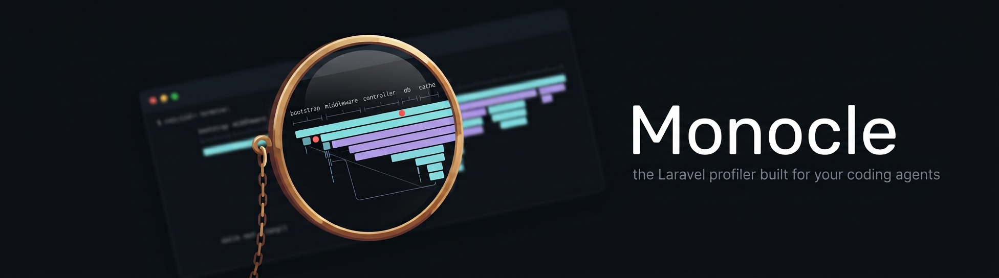

<p align="center"></p>

# Monocle

**Documentation: [exeque.github.io/laravel-monocle](https://exeque.github.io/laravel-monocle/)**

Agent-focused request profiler for Laravel. Monocle records what the application did while handling a request, job or command - timing phases, every middleware, database queries, cache operations, filesystem and AI agent calls, plus spans you add yourself - and exposes it to AI coding agents through an MCP server, to humans through artisan commands, and later through a web dashboard.

Monocle is built from **lenses**: discrete classes that each hook into the framework and write one section of the recorded capture. Enable, disable, configure or add lenses through config or the facade.

## Install

```bash
composer require --dev exeque/laravel-monocle
php artisan monocle:install          # interactive: pick lenses, disks, storage and MCP clients; publishes config/monocle.php
```

Monocle records only outside production and only when `app.debug` is on. Override at runtime from a service provider:

```php
use Monocle;

public function register(): void
{
    Monocle::enabled(fn () => ! $this->app->isProduction());
}
```

When disabled nothing is hooked, so the package is inert in production.

## For agents

Add the MCP server (done by `monocle:install`) and the agent gets:

| Tool | Purpose |
| --- | --- |
| `monocle-list` | Recent captures with duration, status and per-section counts. Filters: type, uri, status, min duration, since, label, has_errors. |
| `monocle-show` | Summary: time breakdown per phase and category, totals, warnings (slow/duplicate/N+1 queries, slow middleware), trace links, and a description of every available section. Add `sections=[timeline, queries, ...]`. |
| `monocle-rows` | Paginated, filterable rows of one section with `where`, `sort`, `fields` projection and `verbose`. |
| `monocle-queries` | Queries grouped by shape, caller, table or transaction. |
| `monocle-trace` | Every capture in the same trace: the request or command that started it and every job it dispatched, with depth and offsets. |
| `monocle-compare` | Diff two captures (by id or label): totals, phases, categories, query shapes and warnings. Label a run, change the code, compare. |
| `monocle-clear` | Empty the ring buffer before reproducing a scenario. |

Every response carries `X-Monocle-Id` and `Server-Timing` headers, so an agent that curls the app can jump straight to `monocle-show id=...`. Every recorded row has an `origin` (user-land `file:line` and a short call chain) so the agent can open the code that triggered it.

The same data is available on the command line: `monocle:list`, `monocle:show`, `monocle:rows`, `monocle:queries`, `monocle:trace`, `monocle:compare`, `monocle:clear` (JSON output, `--compact` for one line).

## Your own spans and metadata

```php
use Monocle;

$span = Monocle::span('import photos')->start(['album' => $album->id]);
// ...
$span->stop(['count' => $count]);         // start(), stop() and meta() all merge metadata
$span->meta(['result' => 'ok']);          // still allowed after stop()

Monocle::measure('resize', fn () => $this->resize($file), ['w' => 800]);
Monocle::mark('cache warmed');
Monocle::meta(['tenant' => $tenant->id]); // metadata on the capture itself

// Hand a span over without passing the object: look it up by key.
Monocle::span('import', key: "import:{$album->id}")->start();
Monocle::span(key: "import:{$album->id}")->stop();
```

Span names are free (ten spans named `resize` are fine); only keys are unique among open spans.

## Configuration

`config/monocle.php` controls everything:

```php
'lenses' => [
    RequestLens::class    => true,
    MiddlewareLens::class => true,
    DatabaseLens::class   => ['slow_ms' => 70, 'n_plus_one_threshold' => 3, 'bindings' => true],
    CacheLens::class      => ['values' => false],
    App\Monocle\MyLens::class => ['option' => 'value'],   // your own
],
'storage' => ['driver' => 'file', 'limit' => 200],        // file (default), cache, or a Store class
'mask'    => ['using' => PartialMask::class],             // invokable ($value, $key) => masked
```

Or from a service provider's `register()`:

```php
Monocle::register(MyLens::class, ['option' => 'value']);
Monocle::disable(EventsLens::class);
Monocle::extendStore('redis-stream', fn ($app, array $config) => new MyStore(...));
```

## Writing a lens

```php
use ExeQue\Monocle\Contracts\Lens;
use ExeQue\Monocle\Contracts\Lenses\Summarizable;

final class MailgunLens implements Lens, Summarizable
{
    public function key(): string { return 'mailgun'; }

    public function description(): string { return 'Outgoing Mailgun API calls with endpoint, status and duration.'; }

    public function boot(Application $app, Eyepiece $eyepiece): void
    {
        $eyepiece->listen(MailgunCalled::class, fn ($e) => $eyepiece->push('mailgun', ['endpoint' => $e->endpoint, 'duration' => $e->ms]));
    }

    public function summarize(Capture $capture): array
    {
        return ['totals' => ['mailgun_calls' => count($capture->rows('mailgun'))]];
    }
}
```

`push()` adds `time` and `origin` automatically. Opt into more lifecycle with `Configurable`, `Finalizable`, `Resettable` and `Summarizable`. See [Writing a lens](docs/writing-a-lens.md).

## Development

```bash
docker compose run --rm composer install
docker compose run --rm php vendor/bin/pest
docker compose run --rm php vendor/bin/pest --coverage --min=90
docker compose run --rm php vendor/bin/pint
```

## License

MIT
